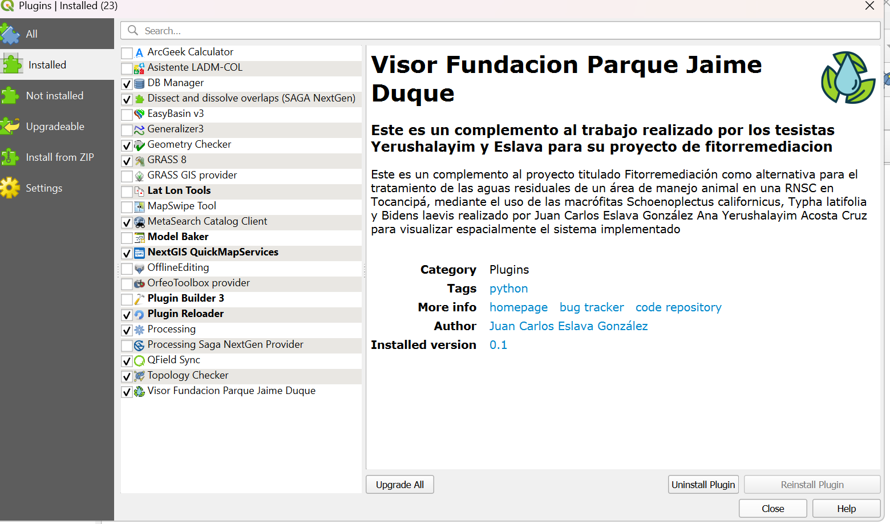
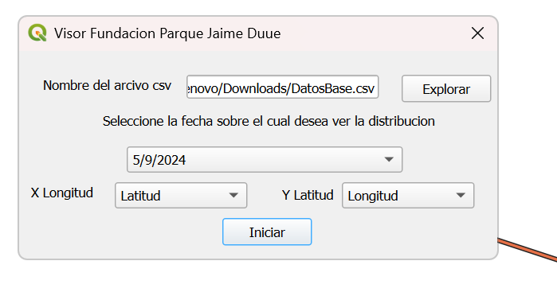
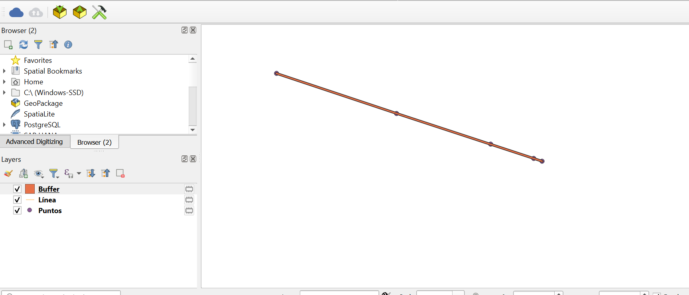

# qgis-water-quality-viewer
QGIS plugin that loads a CSV of water-quality measurements along a channel and displays them georeferenced.
# Water Quality Viewer (QGIS plugin)

Short description of what the plugin does and why.

## Features
- Loads a CSV with dissolved oxygen measurements along a channel
- Georeferences the points and displays them in QGIS

## Screenshots

## Installation
1. Download this repository as ZIP (Code > Download ZIP)
2. In QGIS: Plugins > Manage and Install Plugins > Install from ZIP

## CSV format
Columns required: (list the real column names here)
An example file is included in sample_data.csv

## Credits
Developed by Juan Carlos Eslava González as a complement to a phytoremediation
thesis project (co-author: Ana Yerushalayim Acosta Cruz).

## Requirements
QGIS version tested: (your version)
